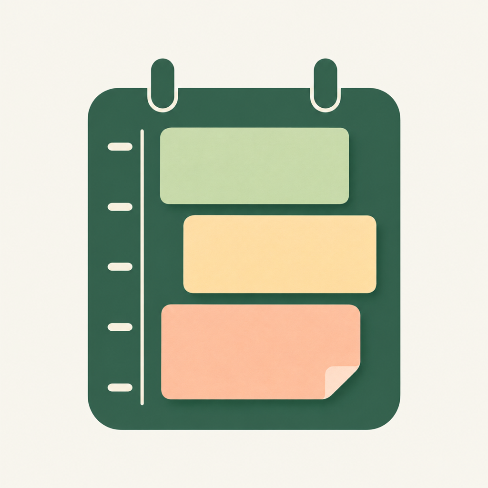

  

# 予定館 / Yoteikan

**付箋を並べて、今日を組み立てる。**

「読書に30分」「集中する時間を1時間」「ちょっと休憩を15分」。
やりたいことに時間を決めて、1日の時間割へ置いていく。

予定館は、付箋を貼り替える感覚で使える、iPhoneのタイムボクシングアプリです。
朝の計画も、途中の予定変更も。自分の手で、今日の過ごし方を整えられます。

  
  

## 朝、やりたいことを付箋にする

まずは内容と所要時間を決めて、付箋置き場へ。
時間割を見ながら、空いているところへドラッグして配置します。
会議や約束はiPhoneのカレンダーから読み込めるので、その合間に自分の時間を組み立てられます。

## 予定が変わったら、その1枚を動かす

開始時刻を変えるときは上下にドラッグ。もう少し時間が必要なら、付箋の下端を伸ばすだけ。
あとで取り組みたいことは、付箋置き場へ戻しておけます。
ほかの予定の時刻を保ったまま、必要な1枚を組み替えられます。

紙のような陰影と折り返し、好きな色と名前。
自分の付箋を並べて、見やすい時間割をつくれます。

## 細かく見る。1日を見渡す。

時間割はピンチで拡大・縮小。短い予定を調整するときは、指で広げてじっくりと。
「空きをたたむ」を押すと、空き時間を縮め、5分の予定も文字が読める高さで表示します。
折りたたんだまま、付箋の配置・移動・伸縮もできます。

「1日表示」では、時間割を画面いっぱいに。
空き時間の横棒グラフとあわせて、今日の余白と全体の流れを確かめられます。

## 毎日の習慣を、いつもの付箋に

読書、運動、ごはん、ひと休み。
よく使う付箋はプリセットに保存して、毎日の準備を手軽に。
1日に追加する枚数も決められるので、「ごはんは3枚」のように、自分の暮らしに合わせて用意できます。

## メモも、リマインダーもそばに

予定を長押しすると、近くに小さなメモのプレビューが表示されます。
指を離すと消えるので、確認したらそのまま計画を続けられます。
詳しく書きたいときは詳細欄から編集・保存。付箋ごとに、開始前のリマインダーも設定できます。

## 自分に合う使い心地へ

- 計画する時間帯の開始・終了を選択。
- 付箋の色と名前を自由にカスタマイズ。
- 付箋・詳細欄を左右の好きな位置へ。
- 横画面では、時間割・詳細メモ・付箋を並べて表示。
- 直前の変更を元に戻して、気軽に組み直し。

計画データは端末内に保存。基本機能はアカウント登録不要です。Google同期を使う場合は、設定の「アカウント・同期」からログインしてDriveのアプリ専用領域へ同期できます。
カレンダーの読み込みと通知は、使いたいときにアクセスを許可して利用できます。

---

現在開発中です。App Store・TestFlightではまだ配信していません。対応はiOS 17以降です。

[詳しい使い方](docs/usage.md) · [Google同期の設定](docs/google-sync.md) · [Web版の起動・公開手順](docs/web.md) · [スクリーンショット](docs/screenshots/README.md) · [開発・起動手順](docs/development.md)

設計・検証の資料：[アプリ設計](docs/design.md) / [動作確認](docs/verification.md) / [テスト結果](docs/test-results.txt) / [通知の仕様](docs/issue-17.md) / [サイドバーの仕様](docs/issue-23.md) / [アプリアイコン](docs/app-icon.md) / [Issue #18〜#20](docs/issues-18-20.md)
