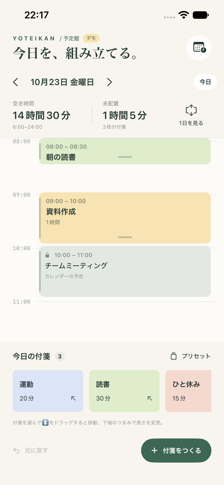

# 予定館 / Yoteikan

朝に1日の予定を組み立てる、iPhone用のタイムボクシングアプリです。カレンダーの固定予定を土台に、「読書・30分」のような付箋を空き時間へ配置します。



## できること

- 内容・所要時間・色・メモ付きの付箋を作成。
- 長押しドラッグで配置し、選択後は右上の↕をドラッグして開始時刻を変更。下端のつまみで延長・短縮。
- 変更するのは触っている1枚だけ。ほかの付箋や会議は自動で動かない。
- 予定の重なりを許可し、並列表示と枠線で知らせる。
- 未配置への戻し、直前の変更を元に戻す、端末内への保存。
- よく使う付箋をプリセットに保存し、今日の計画へ追加。
- iPhoneのカレンダーを読み込み、表示するカレンダーを選択。
- 日付の切り替え、1日全体と拡大表示の切り替え。

## 起動する

macOSと、iOS 17以降をビルドできるXcodeが必要です。

1. このリポジトリを取得し、ios/Yoteikan.xcodeproj をXcodeで開く。
2. Yoteikanスキームと、インストール済みのiPhoneシミュレーターを選ぶ。
3. Runで起動する。

実機ではSigning & CapabilitiesのDevelopment Teamを設定してください。初期版はシミュレーターで検証済みです。実機インストール・TestFlight・App Store配布はまだ行っていません。

## 使い方

1. 右上のカレンダー設定でアクセスを許可し、表示するカレンダーを選ぶ。
2. 「プリセット」から今日やる付箋を追加する。その日だけの用事は「付箋をつくる」から作成する。
3. 下部の未配置の付箋を長押しし、時間割へドラッグする。
4. 配置した付箋をタップして選び、右上の↕を上下にドラッグして開始時刻を変更する。付箋全体を長押しして移動する方法も使える。下端のつまみでは長さを変更する。
5. 下部へドラッグすると未配置へ戻る。タップで選択すると編集・未配置に戻すボタンも表示される。もう一度タップしても編集できる。
6. 「元に戻す」で直前の変更を戻す。

計画範囲は6:00〜24:00、時間は5分刻みです。カレンダーの固定予定は、このアプリから変更できません。

## ドキュメント

| ドキュメント | 内容 |
|---|---|
| [アプリ設計](docs/design.md) | 仕様、データモデル、画面構成、カレンダー権限、初期版の範囲 |
| [開発・検証手順](docs/development.md) | 技術構成、ビルド・テスト、Goによるスクショ出力、テスト用の起動引数 |
| [動作確認](docs/verification.md) | 確認した操作、検証環境、実機で未確認の項目 |
| [スクリーンショット9枚](docs/screenshots/README.md) | 実際に操作して取得した画面 |
| [テスト結果の抜粋](docs/test-results.txt) | Issue #1改善後の全15件成功の記録 |

## 技術構成

アプリはSwift / SwiftUI、カレンダーはEventKit、データは端末内のUserDefaultsに保存します。サーバーやアカウントは不要です。スクリーンショット報告ツールはGoの標準ライブラリで実装し、Pythonへの依存はありません。

## ディレクトリ

```text
ios/          iPhoneアプリ、Xcodeプロジェクト、ユニット・UIテスト
tools/report/ XCTestのスクショを抽出し、HTMLギャラリーを生成するGoツール
docs/         設計、開発手順、検証結果、スクリーンショット
artifacts/    ローカルのビルド・テスト生成物（Git管理対象外）
```
