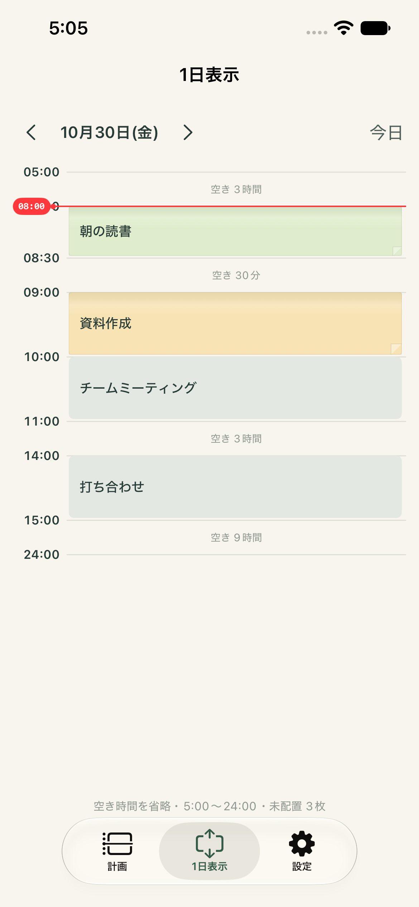

# Issue #52〜#57

## #52：1日表示の日付移動

1日表示の上部に前日・翌日・今日を追加しました。計画画面と日付を共有し、付箋とカレンダーも選択日に合わせて切り替えます。日付移動・計画との共有・今日への復帰をiPhoneシミュレーターのUIテスト45で確認しました（`artifacts/Issue52.xcresult`）。

## #53：付箋のコピー

配置済みの付箋は、動かさずに長押しして指を離すとコピーを選べます。付箋欄は標準の長押しメニューからコピーできます。保存済みのメモ・色・所要時間・通知設定を保ち、新しいIDの未配置付箋として選択日の付箋欄へ追加します。元の付箋は変更しません。コピーは1回の操作として元に戻せます。

単体29件、既存のドラッグ/折りたたみ操作、長押しプレビュー、両領域のコピー操作を検証しました。最終のメニュー操作は `artifacts/Issue53Accept.xcresult`（UI31/46成功）、モデルとドラッグは `artifacts/Issue53.xcresult` を参照。

## #54：時刻の読みやすさ

時刻軸を標準のシステム書体・12ポイントのセミボールドへ変更し、数字の幅を揃えました。時刻欄を広げ、薄すぎた文字の濃さも調整しています。予定内の開始・終了時刻も12ポイントにしています。短い予定の拡大操作と1日表示の日付切替をUI20/45で確認しました（`artifacts/Issue54.xcresult`）。

## #55：折りたたみ予定の余白

折りたたみ中の付箋・カレンダー予定・1日表示に共通のタイトル配置を使い、左右10/上下6ポイントの余白と上下中央配置にしました。短い予定の最低高さも48ポイントに調整し、2行の文字を内側へ収めます。単体29件と短い予定・1日表示のUI27/36、移動/伸縮のUI35を確認しました（`artifacts/Issue55.xcresult`、最終の移動確認は `artifacts/Issue55Drag.xcresult`）。

## #56：計画ページの元に戻す

計画上部に「元に戻す」を追加しました。直前に保存した予定の変更を1回だけ戻し、選択や未保存のメモ表示も復元後の内容へ揃えます。戻せる変更がない場合は無効です。実質的に変更のない操作では、前の有効なUndoを上書きしません。単体30件とUI48（コピー前へ戻る・元の予定の保持・復元後の無効化）が成功しました（`artifacts/Issue56.xcresult`、最終UIは `artifacts/Issue56Undo.xcresult`）。

## #57：文字サイズの設定

設定の最上部の「表示」で90〜150%に調整できます。予定・メモ・時刻・アプリ内の設定文字に即時反映し、端末内へ保存します。「標準に戻す」で100%へ戻せます。時刻の欄幅と折りたたみの最低高さも連動し、大きい文字を収めます。OSのDynamic Typeも反映します。システム管理のメニュー・キーボードは対象外です。

単体31件とUI35/48/49（移動・伸縮、Undo、文字サイズの保持・標準復帰）が成功しました（`artifacts/Issue57.xcresult`）。Mac Catalystでも単体31件が成功し、iPhone実機向けReleaseビルド（署名なし）も成功しています。実機のインストールや操作は未確認です。

