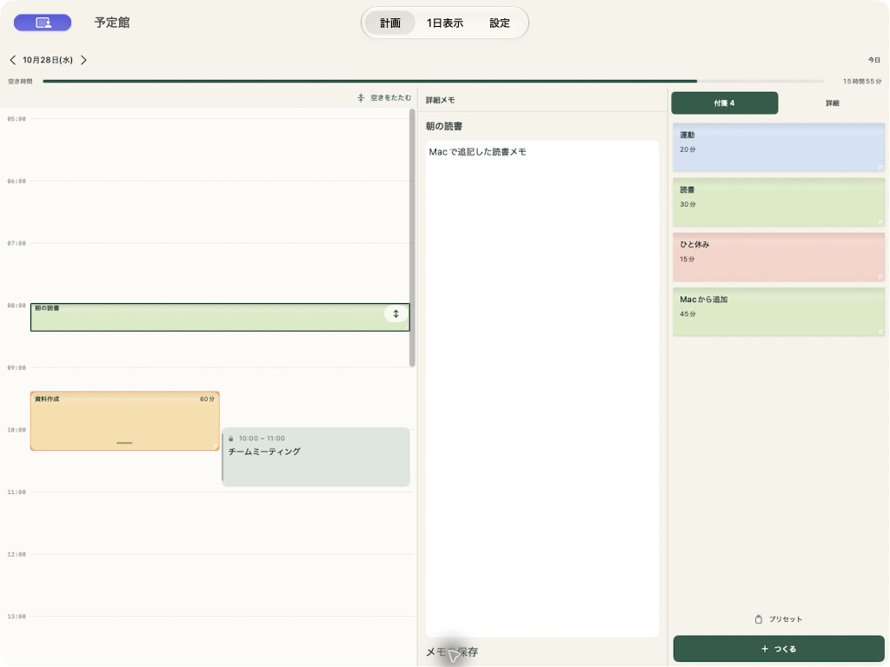

# Mac版（Mac Catalyst）

予定館をMac CatalystでMacアプリとしてビルドします。iPhoneと予定・プリセット・カレンダー読み込みの実装を共有します。macOS 14以降が対象です。Mac自身のカレンダーを固定予定として読み込み、Mac上で通知を予約できます。

## Xcodeで起動

1. `ios/Yoteikan.xcodeproj` を開き、Schemeを **Yoteikan** にします。
2. 実行先を **My Mac (Mac Catalyst)** にします。
3. Signing & Capabilitiesで自身のDevelopment Teamを選びます。署名チームはリポジトリに固定しません。
4. ビルド・実行します。アカウント登録なしで予定を作成できます。

バンドルIDはiPhoneと同じ **`org.sfuji.yoteikan`** を維持し、`maccatalyst.` の接頭辞を自動付与しません。Googleログイン・Drive同期・Webからの参照や編集はありません。

## Macでの操作

- 広いウィンドウは時間割・メモ・付箋の3ゾーンです。詳細表示へ切り替えると2ゾーンになります。最小ウィンドウサイズは780×560ポイントです。
- 未配置付箋はマウスで時間割へドラッグできます。配置済み付箋はマウスを押したまま上下へ動かし、開始時刻を変更できます。伸縮つまみや編集画面から長さを変えられます。
- 付箋や固定予定にポインターを合わせると、小さな詳細プレビューを表示します。ポインターを外すと閉じます。iPhoneの長押し操作は引き続き利用できます。
- メニューバーの「予定」から画面切替、日付移動、拡大・縮小ができます。

|ショートカット|操作|
|---|---|
|⌘N|付箋をつくる|
|⌘1|計画|
|⌘2|1日表示|
|⌘,|設定|
|⌘[ / ⌘]|前の日 / 次の日|
|⌘T|今日|
|⌘+ / ⌘−|時間割を拡大 / 縮小|

## 権限と保存

- カレンダー接続時にMacのカレンダーアクセスを許可します。Mac用のサンドボックス権限を設定しており、予定は読み取りのみです。許可の変更はシステム設定 → プライバシーとセキュリティ → カレンダーから行えます。
- 通知の許可はMac側で行います。iPhoneの通知許可はMacへ同期されません。
- ローカル保存先はMacアプリのコンテナー内です。iPhoneの端末内データが自動的にMacへコピーされるわけではありません。端末ごとに計画を保存します。
- Mac用の派生ビルドを有効にするため、Xcodeの対象デバイスをiPhone/iPadにしています。画面サイズに応じた既存のゾーン配置を利用します。

## コマンドでビルド

```sh
xcodebuild -project ios/Yoteikan.xcodeproj -scheme Yoteikan \
  -destination 'platform=macOS,variant=Mac Catalyst' \
  -derivedDataPath artifacts/mac-build build CODE_SIGNING_ALLOWED=NO
```

テスト：

```sh
xcodebuild -project ios/Yoteikan.xcodeproj -scheme Yoteikan \
  -destination 'platform=macOS,variant=Mac Catalyst' \
  -only-testing:YoteikanTests test
```

Mac App Storeへの配信やDeveloper IDによる公証・インストーラーの作成はこのPRには含めません。

## 確認状況

- 同期削除前はMac Debug / Release（arm64 / x86_64）ビルド、署名付きMacユニットテスト45件が成功。Macサンプルで付箋作成・マウス移動・伸縮・日本語メモ保存・画面切替を実操作で確認しました。
- Google同期削除後のMac Catalyst Debugビルドと単体28件が成功（`artifacts/MacLocalOnly.xcresult`）。iPhoneシミュレーターでは単体28件・UI2件とReleaseビルドが成功。Mac側も同期処理・画面と、不要になったKeychain・外向き通信の権限を削除しました。
- Macの自動UIテストは、前回 `Timed out while enabling automation mode` で初期化に失敗しています。ユーザーの待機指示後、認証待ちの処理を取り消し、DevToolsSecurityが無効のままであることを確認しました。今回、OSの認可設定は変更しません。
- Macの実カレンダー接続・通知配信は未確認です。



### Mac UIテストが自動操作開始前に止まる場合

`Timed out while enabling automation mode` はアプリのテスト項目を実行する前の初期化エラーです。XcodeからUIテストを実行し、Mac上に開発ツールの認可が表示された場合は管理者が内容を確認します。状態の確認は `/usr/sbin/DevToolsSecurity -status` です。

必要に応じて管理者が `sudo /usr/sbin/DevToolsSecurity -enable` で開発ツール用の認可設定を有効にできます。これはApple署名のデバッガー等を使う際、admin / _developerグループの利用者の追加パスワード認証を省略するMac本体の設定変更です。Apple開発プロファイルの取得とは別の操作なので、管理者の明示的な承認なしには実行しません。元に戻すには `sudo /usr/sbin/DevToolsSecurity -disable` を使います。
