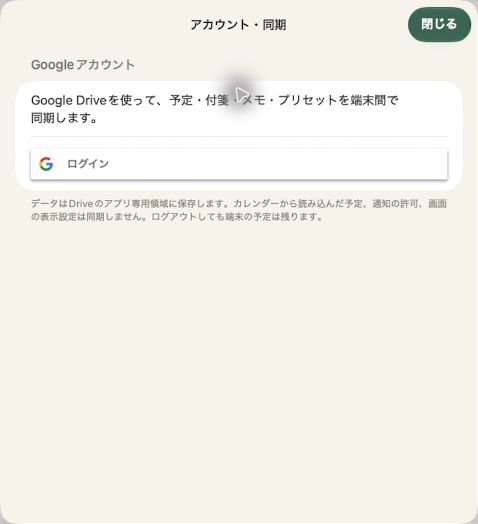

# Mac版（Mac Catalyst）

予定館をMac CatalystでMacアプリとしてビルドします。iPhoneと予定・プリセット・Google Drive同期・カレンダー読み込みの実装を共有します。macOS 14以降が対象です。Web版と異なり、Mac自身のカレンダーを固定予定として読み込み、Mac上で通知を予約できます。

## Xcodeで起動

1. `ios/Yoteikan.xcodeproj` を開き、Schemeを **Yoteikan** にします。
2. 実行先を **My Mac (Mac Catalyst)** にします。
3. Signing & Capabilitiesで自身のDevelopment Teamを選びます。署名チームはリポジトリに固定しません。
4. ビルド・実行します。初回はGoogleログインなしでも、予定を作成できます。

バンドルIDはiPhoneと同じ **`org.sfuji.yoteikan`** を維持し、`maccatalyst.` の接頭辞を自動付与しません。Google設定は [Google同期の手順](google-sync.md) と同じiOSクライアントIDを使います。新プロジェクトの `398026852680-…` を組み込んでいます。Mac CatalystのGoogle認証にはKeychain Sharingが必要なため、Mac用entitlementsにKeychainアクセスグループを指定しています。Xcodeの署名でApp Identifier Prefixを解決してください。未署名ビルドはコンパイル確認用であり、実Googleログイン確認用には使わないでください。

Google公式：[Mac CatalystとKeychain設定](https://github.com/google/GoogleSignIn-iOS#mac-catalyst)

## Macでの操作

- 広いウィンドウは時間割・メモ・付箋の3ゾーンです。詳細表示へ切り替えると2ゾーンになります。最小ウィンドウサイズは780×560ポイントです。
- 未配置付箋はマウスで時間割へドラッグできます。配置済み付箋はマウスを押したまま上下へ動かし、開始時刻を変更できます。伸縮つまみや編集画面から長さを変えられます。
- 付箋や固定予定にポインターを合わせると、小さな詳細プレビューを表示します。ポインターを外すと閉じます。iPhoneの長押し操作は引き続き利用できます。
- メニューバーの「予定」から画面切替、日付移動、拡大・縮小ができます。

|ショートカット|操作|
|---|---|
|⌘N|付箋をつくる|
|⌘1|計画|
|⌘2|1日表示|
|⌘,|設定|
|⌘[ / ⌘]|前の日 / 次の日|
|⌘T|今日|
|⌘+ / ⌘−|時間割を拡大 / 縮小|

## 権限と保存

- カレンダー接続時にMacのカレンダーアクセスを許可します。Mac用のサンドボックス権限を設定しており、予定は読み取りのみです。許可の変更はシステム設定 → プライバシーとセキュリティ → カレンダーから行えます。
- 通知の許可はMac側で行います。iPhoneの通知許可はMacへ同期されません。
- Google Driveへの接続用に、Macサンドボックスの外向きネットワーク通信を許可しています。
- ローカル保存先はMacアプリのコンテナー内です。iPhoneの端末内データが自動的にMacへコピーされるわけではありません。同じGoogleアカウントで同期を開始し、クラウドの予定を読み込みます。
- Mac用の派生ビルドを有効にするため、Xcodeの対象デバイスをiPhone/iPadにしています。画面サイズに応じた既存のゾーン配置を利用します。

## コマンドでビルド

```sh
xcodebuild -project ios/Yoteikan.xcodeproj -scheme Yoteikan \
  -destination 'platform=macOS,variant=Mac Catalyst' \
  -derivedDataPath artifacts/mac-build build CODE_SIGNING_ALLOWED=NO
```

テスト：

```sh
xcodebuild -project ios/Yoteikan.xcodeproj -scheme Yoteikan \
  -destination 'platform=macOS,variant=Mac Catalyst' \
  -only-testing:YoteikanTests test
```

実Google認証・実Drive同期は、署名したMacビルドでログイン・許可操作を行って確認してください。Mac App Storeへの配信やDeveloper IDによる公証・インストーラーの作成はこのPRには含めません。

## 確認状況

- Mac CatalystのDebug / Releaseビルド成功。ReleaseはApple Silicon（arm64）・Intel（x86_64）の両アーキテクチャを確認。Mac上のユニットテスト45件成功。
- iPhoneシミュレーターでユニットテスト45件と、ドラッグ・伸縮・未配置へ戻す操作テスト1件成功。
- Macのサンプルで、⌘Nからの付箋作成、マウスでの開始時刻変更、伸縮つまみによる長さ変更、日本語メモの編集・保存、⌘2の1日表示、⌘,の設定画面、アカウント・同期画面の表示を実操作で確認。
- ユーザー承認後、XcodeからMac Catalyst開発プロファイルを取得し、Apple Developmentによる署名を確認。署名付きMacビルドでもユニットテスト45件成功。署名の整合性とKeychainグループ・ネットワーク・カレンダー権限も確認済みです。
- Mac UIテストは署名付きランナーの起動まで進みましたが、`Timed out while enabling automation mode` で自動操作モードを開始できませんでした。`DevToolsSecurity -status` は無効を返しています。UIテスト本体は実行されておらず、成功とは扱っていません。Mac本体の開発ツール認可が必要です。
- 実Googleログイン・Drive送受信・Macの実カレンダー接続・通知の配信は未確認です。サンプル画面や代替Driveのテストと区別してください。




### Mac UIテストが自動操作開始前に止まる場合

`Timed out while enabling automation mode` はアプリのテスト項目を実行する前の初期化エラーです。XcodeからUIテストを実行し、Mac上に開発ツールの認可が表示された場合は管理者が内容を確認します。状態の確認は `/usr/sbin/DevToolsSecurity -status` です。

必要に応じて管理者が `sudo /usr/sbin/DevToolsSecurity -enable` で開発ツール用の認可設定を有効にできます。これはApple署名のデバッガー等を使う際、admin / _developerグループの利用者の追加パスワード認証を省略するMac本体の設定変更です。Apple開発プロファイルの取得とは別の操作なので、管理者の明示的な承認なしには実行しません。元に戻すには `sudo /usr/sbin/DevToolsSecurity -disable` を使います。
