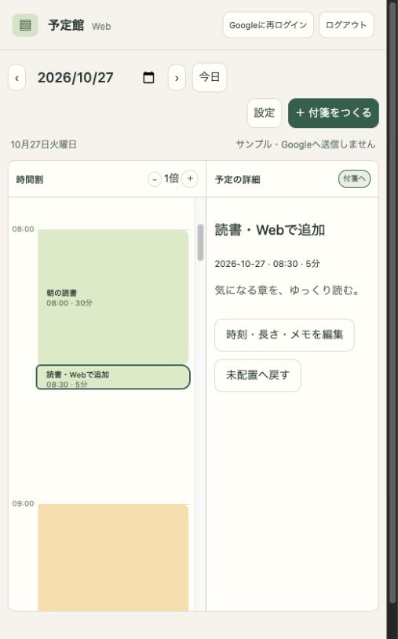

# Webから予定を閲覧・編集する

公開予定URLは **https://yoteikan.sfuji.org** です。この変更はWeb版のソースと起動・公開環境を準備するものです。DNS・GitHub Pages・Google CloudのWeb用ID設定を完了するまでは、このURLで利用できません。

## 構成

公開にはGitHub Pagesを使います。GoでHTML/CSS/JavaScriptと公開設定を静的出力し、GitHub Actionsから配信します。サーバーの契約は不要です。ローカル確認にはGoの単一実行ファイルも使えます。外部Goパッケージ、Nodeの依存パッケージ、Pythonは不要です。Google Identity Servicesの公式ライブラリでブラウザー内に短命のアクセストークンを取得し、Google Driveへ直接アクセスします。サーバーに予定・Google認証情報・クライアントシークレットを保存しません。アクセストークンはメモリーだけに置き、再読み込みや有効期限切れ時はログインし直します。

ブラウザーのローカル保存にはアカウント別の変更履歴を保存します。共有パソコンではブラウザーのプロファイルを分けてください。ログアウトすると表示を閉じますが未送信変更を含むローカル履歴は残します。履歴を消す場合は必要な同期が完了したことを確認して、そのサイトのブラウザーデータを削除してください。

Googleログインなしの「サンプルで試す」は専用領域で動き、実アカウントのDriveへサンプルを送信しません。

## Google Cloudの設定（利用者が行う作業）

**新しいiOSクライアント `398026852680-…` を作ったプロジェクトと同じプロジェクト**を選びます。旧プロジェクトのIDを使うと、iPhoneのデータと別の領域になるため同期できません。

1. Google Drive APIを有効にします。認証成功とAPI利用可能は別です。403になったときは最初にここを確認します。
2. Google Auth Platform → 対象で「外部」「テスト」を選び、実際に使うGoogleアカウントをテストユーザーに追加します。開発段階では審査申請でなくテストユーザー設定から始められます。テスト状態では認可・リフレッシュトークンに7日間の制約があります。
3. データアクセスには `https://www.googleapis.com/auth/drive.appdata` とログイン用 `openid` / email / profile を登録します。Drive全体の読み書き権限は不要です。
4. クライアント → クライアントを作成 → 種類 **ウェブアプリケーション** を選びます。iOS用IDを流用しません。
5. 承認済みのJavaScript生成元に次を登録します（末尾スラッシュやパスは含めません）。
   - `http://localhost:8080`
   - `https://yoteikan.sfuji.org`
6. この実装はGoogle公式のポップアップ型トークンモデルです。承認済みリダイレクトURIは不要です。iOS用の逆順IDスキームもWebには登録しません。
7. 作成された `….apps.googleusercontent.com` を `GOOGLE_WEB_CLIENT_ID` に設定します。クライアントIDは公開識別子です。クライアントシークレットは使用しません。

公式資料：[トークンモデル](https://developers.google.com/identity/oauth2/web/guides/use-token-model) / [OAuthの対象](https://support.google.com/cloud/answer/15549945) / [Drive API有効化](https://developers.google.com/workspace/guides/enable-apis)

## ローカルで起動

Go 1.23以降を使用します。

```sh
cd web
GOOGLE_WEB_CLIENT_ID='取得したWeb用ID.apps.googleusercontent.com' go run .
```

ブラウザーで **http://localhost:8080** を開きます。`127.0.0.1` と `localhost` はGoogleの設定上異なる生成元です。ブラウザーは登録した `localhost` で開いてください。未設定でも `go run .` でサンプルを操作できます。

```sh
cd web
go test ./...
node --test test/*.test.mjs
```

Swiftで生成した `web/test/swift-fixture.json` に対して、MutationのJSON正規化・Base64・SHA-256が一致することを確認します。再生成はリポジトリルートで `swift tools/web-sync-fixture.swift > web/test/swift-fixture.json` です。

## GitHub Pagesで公開する

既存の `sfuji.org` のPages設定は変更せず、**`sfujibijutsukan/yoteikan` リポジトリのプロジェクトサイト**に `yoteikan.sfuji.org` を設定します。Web画面はすべて静的ファイルで、実行時のGoサーバー・DB・クライアントシークレットは不要です。

1. Web用OAuthクライアントIDを前述の手順で発行します。
2. `sfujibijutsukan/yoteikan` → Settings → Secrets and variables → Actions → **Variables** → New repository variable で、名前 `GOOGLE_WEB_CLIENT_ID`、値にWeb用IDを保存します。公開される識別子なのでSecretでなくVariableです。
3. このPRをmainへ取り込みます。
4. 同じリポジトリの Settings → Pages → Build and deployment → Source を **GitHub Actions** にします。
5. 同じPages設定の Custom domain に **`yoteikan.sfuji.org`** を保存します。GitHubがドメイン所有権の確認を求める場合は、個人アカウントの Settings → Pages で指定されたTXTレコードをDNSへ登録します。設定対象は予定館のリポジトリです。既存の `sfuji.org` を設定しているリポジトリは変更しません。
6. `sfuji.org` のDNS管理画面に次を追加します。

|種類|名前 / ホスト|値 / 宛先|
|---|---|---|
|CNAME|`yoteikan`|`sfujibijutsukan.github.io`|

DNS画面が完全な名前を求める場合は `yoteikan.sfuji.org` と入力します。CNAMEの値には `https://` や `/yoteikan` を付けません。既存のルートドメインのA・AAAA・CNAMEレコードは触りません。Cloudflareを利用している場合、最初はプロキシを無効（DNSのみ）にしてGitHubのDNS確認・証明書発行を行います。

7. Actions → **Deploy Yoteikan Web to Pages** → Run workflow（main）を実行します。初回は手動実行し、以後はWeb関連のmainへの更新時に自動デプロイします。`GOOGLE_WEB_CLIENT_ID` が未設定ならデプロイはスキップします。
8. DNSチェックと証明書発行の完了後、Settings → Pages の **Enforce HTTPS** を有効にします。反映には時間がかかることがあります。
9. `https://yoteikan.sfuji.org` でGoogleログインして同期を確認します。

GitHub Actionsで配信する場合、`CNAME` ファイルではなくPagesのCustom domain設定が必要です。この変更ではCNAMEファイルを生成しません。

静的出力だけをローカルで確認する場合：

```sh
cd web
GOOGLE_WEB_CLIENT_ID='取得したWeb用ID.apps.googleusercontent.com' go run . -export dist
```

`dist/` には `index.html`・CSS・JavaScript・公開ID入り `config.json`・`.nojekyll` だけが出力されます。生成物はGit管理しません。アセットは相対パスなので、カスタムドメイン設定前のリポジトリ配下でもサンプルを開けます。ただしGoogleログインには、実際に開くURLの生成元をOAuthへ登録する必要があります。

公式資料：[GitHub Pages](https://docs.github.com/en/pages/getting-started-with-github-pages/what-is-github-pages) / [サブドメインの設定](https://docs.github.com/en/pages/configuring-a-custom-domain-for-your-github-pages-site/managing-a-custom-domain-for-your-github-pages-site) / [Actionsでの配信](https://docs.github.com/en/pages/getting-started-with-github-pages/using-custom-workflows-with-github-pages)

## 操作・同期範囲

- 日付を選び、時間割・詳細メモ・未配置付箋の3ゾーンで閲覧します。狭い画面では2ゾーンになり付箋と詳細を切り替えます。
- 付箋を作成し、タイトル・長さ・日付・開始時刻・色・メモ・通知の何分前設定を編集できます。プリセットからの付箋追加にも対応します。
- パソコンでは付箋を時間割へドラッグして5分刻みで配置できます。付箋置き場へ戻すと未配置になります。タッチ端末やキーボード操作では詳細の編集画面から時刻を入力します。
- 長さは編集画面で変更します。Web版に伸縮つまみ・ピンチ操作はまだありません。短い予定は文字が収まる高さを確保し、同時刻の予定は横に並べます。拡大ボタンでさらに広げられます。
- 計画の時間帯は設定から変更し、iPhoneへも同期します。範囲外の付箋は元の時刻を保って未配置側へ表示します。
- 編集から約2秒後、ログイン時、および「今すぐ同期」で同期します。ページを閉じている間は同期しません。閲覧中のiPhone側の更新は「今すぐ同期」で取り込みます。
- 変更履歴はiPhoneと同じversion 1・appDataFolder・`yoteikan=sync-v1`形式を使います。iPhoneの色・プリセット・日々の生成記録も読み取り・保持します。Webではプリセットの編集・毎日の自動生成は行いません。
- 同じ項目への同時編集は候補を表示し、利用者が残す内容を選びます。候補が決まるまでその項目は編集できません。異なる付箋の編集と削除は統合します。
- iPhoneのカレンダー由来の固定予定やOSの権限・表示設定は同期されません。通知の配信はiPhoneがデータを受信した後にiPhone側で行います。
- 複数タブの保存・同期はWeb Locksで直列化します。Web Locksに対応する最新のSafari・Chrome・EdgeをHTTPS（開発時はlocalhost）で使います。

## 実接続の受入確認

Web用IDが未発行の段階ではサンプルと代替Driveで検証します。実接続は次を完了後に確認してください。

1. 新プロジェクトのiOSクライアントIDを組み込んだiPhoneで同期し、未送信がないことを確認。
2. Webで同じGoogleアカウントを選択してログインし、iPhoneの付箋とメモが表示されることを確認。
3. Webで確認用付箋を1枚追加・配置・編集し、iPhoneの「今すぐ同期」で内容を確認。
4. iPhoneで別の付箋を編集・削除し、Webの「今すぐ同期」で確認。
5. 同じ付箋をそれぞれオフラインで変更し、オンライン復帰時に競合選択が表示され、結果が両方に反映されることを確認。
6. ログアウト・別アカウントでログインし、前のアカウントの予定が混ざらないことを確認。

サンプルや代替Driveテストの成功は、Google Cloud設定や実機間同期の成功を意味しません。実接続・DNS・HTTPS公開の完了は別途確認が必要です。

## 今回の検証結果

- Goの配信・設定・静的出力・セキュリティヘッダー・ソース非公開のテスト3件成功、実行ファイルのビルド成功。
- Nodeの同期テスト9件成功：Swiftとのハッシュ一致、日本語データ、オフライン統合、削除・編集競合、不正データ拒否、日次枚数の統合、送信失敗と再試行、取得済み履歴、Driveのページ送り・multipart・エラー分類。
- GitHub Pages用の静的ファイル出力を検証。実際のGitHub Actions実行・DNS・HTTPS公開は設定待ちです。PagesにはGoサーバーのHTTPヘッダーを設定できないため、CSPとリファラー設定はHTMLのmetaにも指定しています。
- ローカルの実ブラウザーでサンプルを開き、5分の予定への変更、時刻・メモ保存、付箋のドラッグ配置、詳細切り替え、再読み込み後の保持と時間帯変更を確認。さらにPagesと同じ静的配信でもプリセットから5分の付箋を作成・配置できることを確認。実Google接続ではありません。


